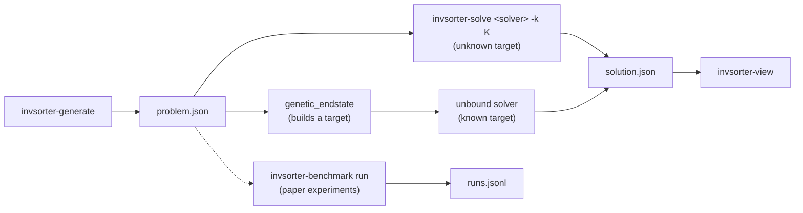

# Inventory Management

Code for the paper *Classical Frameworks for New Challenges: Solving the Inventory Management Problem*.

An inventory is a grid of typed items. A **swap** exchanges the contents of two cells. The score
sums a type-similarity value over all pairs of adjacent items. Two problems are solved:

- **Unknown target (bound):** find at most *K* swaps that maximise the score.
- **Known target (unbound):** given a target inventory, find a shortest swap sequence that reaches it.



## Install

Requires Python 3.12+.

```bash
uv sync --extra planning --extra dev        # or: pip install -e ".[planning,dev]"
```

- **Gurobi** (`ilp_type`, `ilp_type_nocard`) needs a full license; the pip-bundled license only
  handles tiny models. Academic licenses are free: <https://www.gurobi.com/academia/>.
- **Planning** (`planning_reconstructor`) needs the `planning` extra (Unified Planning + Fast Downward).

## Solvers

| Name | Paper | Backend |
|---|---|---|
| `sat_type` | SAT | Z3 |
| `ilp_type` | ILP | Gurobi |
| `ilp_type_nocard` | ILP (no card.) | Gurobi |
| `smt3` | OMTI-Unknown | Z3 |
| `smt3_max` | OMTI-Unknown, second implementation | Z3 |
| `smt9` | OMTE-Unknown | Z3 |
| `smt4` | OMT with parallel swaps | Z3 |
| `cp` | CP | OR-Tools CP-SAT |
| `greedy` | Greedy | - |
| `genetic` | Genetic | - |
| `smt5_swap` | OMTI-Known | Z3 |
| `smt6` | OMTE-Known | Z3 |
| `planning_reconstructor` | Planning | Fast Downward |
| `greedy_reconstructor` | Greedy-R | - |

The first ten are bound solvers, the last four unbound solvers.

## Usage

Generate problems (`-W` width, `-H` height, `-n` items, `-t` types, `-c` count, `-s` seed):

```bash
invsorter-generate -W 4 -H 4 -n 8 -t 2 -c 5 -o problems
```

Solve with a bound solver (`-k` swap budget, `-t` timeout in seconds):

```bash
invsorter-solve ilp_type problems/p0000.json -k 3 -o solution
```

Solve with an unbound solver; the target is built by `genetic_endstate`:

```bash
python -m invsorter.solvers.pipeline problems/p0000.json \
    --generator genetic_endstate --unbound smt6 -o solution
```

Show a problem or solution:

```bash
invsorter-view solution.json
```

## Benchmarks

Results are appended to a JSONL file. An interrupted run resumes where it stopped. All runs use
master seed `0`, so every solver sees the same instances. Add `--workers N` to run cells in
parallel. A cell is only started while at least 10 GiB of RAM are free.

Commands for the paper's experiments:

```bash
# Unknown target: all bound solvers, K = 1..3, 10 configurations, 900 s
invsorter-benchmark run --db results/bounded.jsonl --suites bounded --replicas 1

# ILP with and without cardinality constraints
invsorter-benchmark run --db results/cardinality.jsonl --suites bounded \
    --solver ilp_type --solver ilp_type_nocard --replicas 5 \
    --dims 3x3x4x2 3x3x8x2 4x4x8x2 4x4x10x3 4x4x12x3 4x4x16x4 6x6x20x4 6x6x30x5

# ILP additional constraints (symmetry flags)
invsorter-benchmark run --db results/symmetry.jsonl --suites symmetry_sweep \
    --solver ilp_type --instances 50 --replicas 2 \
    --dims 3x3x4x2 3x3x8x2 4x4x8x2 4x4x12x3 5x5x20x4 6x6x30x5 8x8x20x4

# Greedy vs. genetic, 10x10 to 100x100, K = 10 (4 h timeout per cell)
invsorter-benchmark run --db results/scaling.jsonl --suites runtime_compare

# Known target: all unbound solvers, 900 s
invsorter-benchmark run --db results/unbounded.jsonl --suites unbounded --replicas 1

# Type reordering on the two example instances
python experiments/type_reordering/run.py

# Parallel swaps (smt4; described in the paper, no reported figure)
invsorter-benchmark run --db results/smt4.jsonl --suites smt4 \
    --dims 3x3x4x2 3x3x8x2 --replicas 1
```

Each dimension is `ROWSxCOLSxITEMSxTYPES`. `--timeout` overrides a suite's default timeout.
Inspect progress and check a result file:

```bash
invsorter-benchmark status --db results/bounded.jsonl
invsorter-benchmark verify --db results/bounded.jsonl
```

Instances and seeds are deterministic. Two things depend on the machine: which cells finish
before the wall-clock timeout, and the known-target targets. Those targets come from
`genetic_endstate` with a 3 s time budget. The type-reordering targets ship with the
repository in `experiments/type_reordering/targets/`.

## Tests

```bash
pytest invsorter/tests
```

## License

MIT, see [LICENSE](LICENSE). To cite this work, use [CITATION.cff](CITATION.cff).
